<div align="center">

<a href="#jantra-ai-runtime">
  
</a>

<br />

<a href="#core-architectural-metrics">
  
</a>

<br />

[](package.json)
[](tsconfig.json)
[](src/model/gemini.ts)
[](src/server/app.ts)
[](src/runtime/evals/regressions.ts)

<br />

**[Quickstart](#quickstart)** &nbsp;•&nbsp;
**[Architecture](#technical-architecture)** &nbsp;•&nbsp;
**[Pipeline Stages](#the-3-stage-planning-pipeline)** &nbsp;•&nbsp;
**[Deterministic Grounding](#deterministic-citation-verification)** &nbsp;•&nbsp;
**[API Reference](#fastify-api-reference)** &nbsp;•&nbsp;
**[Agent Catalog](#agent-catalog)** &nbsp;•&nbsp;
**[Deployment](#production-deployment)**

</div>

<br />

<p align="center">
  
</p>

## Product Identity &amp; Philosophy

<p align="center">
  
</p>

**Jantra AI** (*from Sanskrit / Hindi यन्त्र / jantra — machine, precision mechanism, apparatus*) is an autonomous agent runtime and human-gated product planning pipeline engineered for teams that cannot afford hallucinations, runaway spend, or silent failures.

In enterprise and operations AI, **trust is the product**. Jantra transforms raw, unstructured product concepts into production-grade engineering artifacts (`PRD.md`, `TRD.md`, `build_plan.md`) through a disciplined, stage-gated pipeline where every claim is verified deterministically against real source text, every draft is subjected to a dual-pass rubric critic, and every token, tool call, and policy decision is permanently sealed in an append-only audit trail.

> **"You can see everything it did, and why."**  
> We never fabricate market evidence. We never fail open on verification. When a claim cannot be proven from retrieved sources, Jantra abstains.

---

### Core Architectural Guarantees

| Guarantee | Mechanism | Runtime Enforcement |
|:---|:---|:---|
| **Deterministic Grounding** | `citationVerifier.ts` | Regex &amp; text normalization scans raw source windows (400 chars) for cited quotes. Claims that fail verification are purged. |
| **Generator ≠ Critic** | `evaluator.ts` + Rubrics | No stage accepts its own first draft. Artifacts must pass a multi-criteria evaluation matrix before reaching the human gate. |
| **Fail-Closed Security** | `policy.ts` + `netGuard.ts` | Blocks prompt injections in retrieved web content, rejects SSRF/private IPs, and halts upon budget ceiling breaches. |
| **Human-in-the-Loop Gates** | Stage confirmation I/O | Every stage output must be confirmed by an operator before downstream execution commences. |
| **Sub-Cent Cost Governance** | Reserve &amp; Settle Telemetry | Per-turn token pricing, daily client limits, and hard cost ceilings prevent runaway model bills. |
| **100% Offline Verifiability** | `MockProvider` + 20 Regressions | Full test suite and pipeline run deterministically with zero credentials, zero network, and zero API cost. |

<p align="center">
  
</p>

## Product In Action

Experience how Jantra executes a complete product planning engagement from terminal initialization to final artifact sealing:

<p align="center">
  
</p>

```bash
# Run the pipeline locally with offline mock provider (zero credentials required)
npm run smoke

# Run the live interactive pipeline on Gemini 2.5
npm run pipeline -- --client="xolver" --title="Automated Logistics Reconciliation"
```

<p align="center">
  
</p>

## Architectural Pillars

<p align="center">
  
</p>

### 1. Ground or Abstain (Deterministic Citation Verification)
Research agents fan out across web sources, index content, and extract market evidence. But models are not trusted to verify their own citations:
- Citations are verified deterministically by `citationVerifier.ts`.
- The verifier loads the raw source text buffer, extracts a surrounding 400-character window (`SKEPTIC_EXCERPT_RADIUS`), normalizes whitespace and punctuation, and validates that the cited quote exists verbatim.
- If a claim lacks an authentic source quote or takes an excerpt out of context, the claim is flagged as ungrounded and purged from the report.

### 2. Generator ≠ Critic (Dual-Pass Rubric Verification)
In standard agent loops, models suffer from self-confirmation bias. Jantra enforces structural separation:
- A stage's generator draft is routed to an independent Critic evaluator.
- The Critic grades the draft against the stage's specific rubric (e.g. Technical Feasibility, Boundary Specifications, Grounding, Risk Matrix).
- Only when the score clears the acceptance threshold is the artifact presented to the human gate.

### 3. Immutable JSONL Audit &amp; Sub-Cent Telemetry
Every action is audited synchronously:
- Append-only records are written to `.jantra/audit/<runId>.jsonl`.
- Valid audit events: `run_created`, `model_call`, `model_usage`, `tool_call`, `policy_decision`, `citation_verified`, `citation_rejected`, `guardrail_block`, `stage_gate`, `cost_rollup`.
- Sub-cent financial tracking: Input and output tokens are priced per model, with budget reservation and settlement preventing spend overshoot.

### 4. Human Gates &amp; Fail-Closed Boundaries
- **Abstracted Gate I/O**: The CLI prompt, web dashboard, and desktop console all implement the same `StageContext.io` interface. Nothing advances to the next stage without explicit human sign-off.
- **Untrusted Web Content Sanitization**: Pages retrieved during research are marked as reference material only (`sanitizeUntrustedWebContent`), stripping prompt-injection attempts and instruction hijacking.
- **NetGuard**: HTTP fetches during research block private IP ranges, loopback interfaces, and metadata endpoints (SSRF defense).

<p align="center">
  
</p>

## Technical Architecture

The Jantra monorepo is structured into a modular hierarchy spanning edge proxies, Fastify servers, stage runners, and native client interfaces:

<p align="center">
  
</p>

### Repository Layout

```text
src/
  agent.ts                 Provider-backed runtime loop with policy, audit, tools, and handoff
  audit.ts                 Append-only JSONL audit trail (<auditDir>/<runId>.jsonl)
  config.ts                Centralized environment parsing (never read process.env elsewhere)
  policy.ts                Guardrails, prompt-injection detection, and artifact checks
  types.ts                 Core interfaces: ToolDef, Policy, AgentSpec
  model/                   Provider abstraction: Gemini 2.5, OpenAI-compatible, Mock
  agents/                  Agent definitions and registry (intake, planning, ops, support)
  pipeline/                Project store, orchestrator, execution state, and run locks
    stages/                Intake (multi-turn), Research (grounded), Planning (rubric-gated)
    research/              citationVerifier.ts, sourceRegistry.ts, webFetch.ts, schemas.ts
    ops/                   formulaEngine.ts, anomalyEngine.ts, connectors/
  runtime/                 Evaluator loop, telemetry, budgets, typed errors, and evals
    evals/                 20 offline regressions, judge.ts, smoke.ts
  server/                  Fastify v5.8 API server with auth, tenancy, rate limiting, SSE
    routes/                runs, interactions, artifacts, audit, events, agents, webhooks
    auth/                  Scoped API keys, constant-time verification, tenancy
web/                       React 19 + Vite operator console workspace
desktop/                   Electron native desktop application workspace
packages/
  client/                  Typed TypeScript API client SDK
  embed-widget/            Embeddable visitor intake chat widget
deploy/
  cloudflare-worker/       Cloudflare Worker edge proxy script and wrangler config
```

<p align="center">
  
</p>

## The 3-Stage Planning Pipeline

The flagship pipeline in Jantra takes a client from raw napkin idea to an engineering-ready build plan:

<p align="center">
  
</p>

```
  ┌────────┐     Gate 1     ┌──────────┐     Gate 2     ┌──────────┐      ┌─ Deferred ──┐
  │ Intake │ ─────────────► │ Research │ ─────────────► │ Planning │ ····►│    Build    │
  └────────┘  (Confirm/Halt) └──────────┘  (Confirm/Halt) └──────────┘      └─────────────┘
  idea_summary.md           research_report.md          prd.md, trd.md,      (Out of scope;
                             (cited & verified)         build_plan.md        remains disabled)
```

| Stage | Inputs | Execution Model | Output Artifact | Verification Mechanism |
|:---|:---|:---|:---|:---|
| **01. Intake** | Raw concept | Multi-turn conversational agent with `submit_summary` tool | `idea_summary.md` | Schema-validated summary; requirements, constraints, and risks categorized |
| **GATE #1** | Summary artifact | Human Operator Sign-off | Confirmed State | Explicit operator approval via CLI, Web Console, or API call |
| **02. Research** | Confirmed idea | Concurrent web fetch (concurrency: 4), source indexing | `research_report.md` | `citationVerifier.ts` deterministic quote check + skeptic judge |
| **GATE #2** | Cited report | Human Operator Sign-off | Confirmed State | Explicit operator confirmation of verified market facts and risks |
| **03. Planning** | Idea + Research | Document synthesis with Generator ≠ Critic pass | `prd.md`, `trd.md`, `build_plan.md` | Multi-criteria Rubric Matrix; must achieve ≥9.0 score to accept |
| *04. Build* | Specs + Plan | Agentic coding with human driver | Code Repository | *Deferred — out of scope to maintain planning discipline* |

<p align="center">
  
</p>

## Telemetry &amp; System Health

<p align="center">
  
</p>

Jantra maintains rigorous operational boundaries:
- **Zero Hallucination Policy**: Claims without direct, verbatim source evidence are purged prior to artifact delivery.
- **Run Locks (`withRunLock`)**: Concurrency mutex per project prevents parallel corrupting writes to stage states.
- **Fail Closed**: In the event of a provider outage, rate limit exhaustion, or schema mismatch, the pipeline stops and hands off with complete context. It never ships a degraded artifact silently.

<p align="center">
  
</p>

## Agent Catalog

Jantra comes pre-configured with a suite of domain agents registered in `src/agents/registry.ts`:

<p align="center">
  
</p>

1. **`planning-pipeline`** *(Status: Usable)*: The core human-gated product planning pipeline (Intake → Research → Planning).
2. **`intake-public`** *(Status: Implemented)*: Public visitor discovery and lead qualification widget with strict per-visitor rate and cost controls.
3. **`ops-reporting`** *(Status: Prototype / Framework Live)*: Back-office metric aggregation, formula engine, and anomaly detection.
4. **`ops-onboarding`** *(Status: Prototype)*: Connector discovery and schema mapping for Stripe, Shopify, and CSV streams.
5. **`support-agent`** *(Status: Reference Demo)*: Multi-turn customer support demo with tool loops, escalation, and policy checks.
6. **`firebnb-concierge`** *(Status: Client Vertical)*: Domain-tuned hospitality concierge with guest lookup and booking tools.

<p align="center">
  
</p>

## Quickstart

### Prerequisites

- Node.js ≥ 20.0.0
- npm ≥ 10.0.0
- Gemini API Key (for live research; mock provider works offline without keys)

### 1. Installation

```bash
# Clone the repository
git clone https://github.com/DecoyINDIA/AI_Jantra.git
cd AI_Jantra

# Install dependencies across all npm workspaces
npm ci
```

### 2. Environment Configuration

```bash
# Copy example environment variables
cp .env.example .env
```

Key environment configurations in `.env`:

```bash
# Provider selection: "gemini" | "mock" | "openai-compatible"
JANTRA_PROVIDER=gemini
GEMINI_API_KEY=your_gemini_api_key_here

# Model overrides (Gemini 2.5 Flash / Pro)
JANTRA_MODEL_INTAKE=flash
JANTRA_MODEL_RESEARCH=pro
JANTRA_MODEL_PLANNING=pro

# Budget and concurrency ceilings
JANTRA_COST_CEILING_USD=10.00
JANTRA_THINKING_BUDGET=4096
JANTRA_RESEARCH_CONCURRENCY=4
JANTRA_MAX_SOURCES=24
JANTRA_EXPLICIT_CACHE=true

# Storage directories
JANTRA_DATA_DIR=.jantra
JANTRA_AUDIT_DIR=.jantra/audit
JANTRA_PROJECT_DIR=.jantra/projects
```

### 3. Verification &amp; Testing (Zero-Cost Offline)

Run the comprehensive offline test and regression suite:

```bash
# Typecheck all workspaces (root, web, desktop, client, embed-widget)
npm run typecheck

# Run the 20 offline regression tests (auth, tenancy, citations, budgets, netGuard)
npm run eval

# Run full pipeline offline smoke test (Intake -> Research -> Planning with mock provider)
npm run smoke

# Run Fastify HTTP server smoke test
npm run server:smoke
```

### 4. Running the Pipeline

```bash
# Launch the CLI planning pipeline
npm run pipeline

# Or run the support agent demo
npm run support
```

### 5. Running the Operator Web Console &amp; Desktop App

```bash
# Start the Fastify API backend
npm run server

# In a separate terminal, launch the React 19 operator console
npm run web:dev

# Launch the Electron desktop app
npm run desktop:dev
```

<p align="center">
  
</p>

## Fastify API Reference

The Fastify server (`src/server/app.ts`) exposes authenticated REST and Server-Sent Events endpoints:

| Endpoint | Method | Scope | Description |
|:---|:---:|:---:|:---|
| `/health` | `GET` | Public | Side-effect-free service readiness probe |
| `/v1/agents` | `GET` | Authenticated | List all registered agent definitions and stage counts |
| `/v1/runs` | `POST` | Authenticated | Initialize a new agent run (scoped to tenant `clientId`) |
| `/v1/runs/:id` | `GET` | Authenticated | Retrieve run state, stage statuses, and cost rollup |
| `/v1/runs/:id/advance` | `POST` | Authenticated | Advance the active stage to the next step or gate |
| `/v1/runs/:id/confirm` | `POST` | Authenticated | Confirm a pending stage gate and trigger downstream stage |
| `/v1/runs/:id/reject` | `POST` | Authenticated | Reject artifact with feedback for re-generation |
| `/v1/events` | `GET` | Authenticated | SSE live event stream for stage updates and thinking traces |
| `/v1/artifacts/:id` | `GET` | Authenticated | Retrieve generated markdown artifacts (`idea_summary`, `prd`, etc.) |
| `/v1/audit/:id` | `GET` | Admin / Scoped | Download full JSONL audit log for a project |
| `/v1/leads` | `POST` | Public / Scoped | Capture visitor leads from `packages/embed-widget` |

<p align="center">
  
</p>

## Production Deployment

### Render Deployment (Persistent Disk)

`render.yaml` defines the starter web service paired with a 1 GB persistent disk mounted at `/data/jantra`:

```yaml
services:
  - type: web
    name: jantra-runtime
    runtime: node
    plan: starter
    region: singapore
    disk:
      name: jantra-data
      mountPath: /data/jantra
      sizeGB: 1
    envVars:
      - key: JANTRA_DATA_DIR
        value: /data/jantra
      - key: JANTRA_PROJECT_DIR
        value: /data/jantra/projects
      - key: JANTRA_AUDIT_DIR
        value: /data/jantra/audit
      - key: JANTRA_LEAD_DIR
        value: /data/jantra/leads
```

- Health check probe: `GET /health` (unauthenticated, side-effect-free).
- Persistent data: SQLite project state, append-only JSONL audit trails, captured leads, and ops datasets are retained across container recycles.

### Cloudflare Worker Edge Proxy

The edge proxy in `deploy/cloudflare-worker/` provides low-latency tenant routing, rate-limiting, and public intake proxying. Validate the edge proxy using:

```bash
npm run edge:verify:local
```

<p align="center">
  
</p>

## Master Plan &amp; Project Documentation

- **[Validation &amp; Follow-Up](docs/jantra-master-plan/12_VALIDATION_AND_FOLLOW_UP.md)**: Current implementation evidence, audit checklist, and verification status.
- **[Master Planning Package](docs/jantra-master-plan/README.md)**: Roadmap, task packets, architectural decisions, and milestones.
- **[Onboarding Pipeline Design](docs/PIPELINE.md)**: Deep dive into the stage-gated intake, research, and planning runners.
- **[Product Requirements Document](docs/PRD.md)**: Product vision, ICP, market analysis, and economic models.
- **[Desktop Installation Guide](docs/DESKTOP_INSTALL.md)**: Running Jantra inside the Electron environment.
- **[Embedding Guide](docs/EMBEDDING_GUIDE.md)**: Integrating `@jantra/embed-widget` on marketing websites.

<br />

<p align="center">
  <a href="#jantra-ai-runtime">
    
  </a>
</p>

<div align="center">

**Jantra AI Runtime** &nbsp;•&nbsp; Built by **[Xolver Studio](https://github.com/DecoyINDIA)** &nbsp;•&nbsp; Licensed for Enterprise &amp; Studio Operations

</div>
